# Craft

A Minecraft-style voxel world in the browser, built on [Projector](https://github.com/ChrisDrae/Projector).

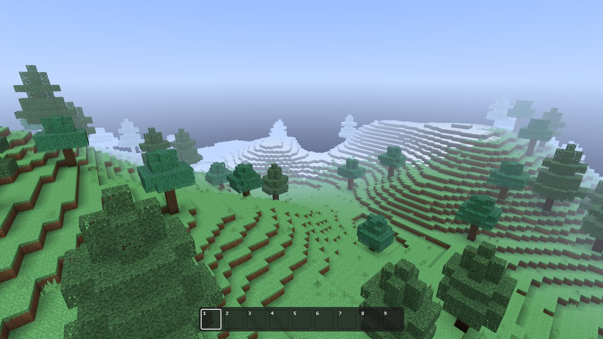

Seeded terrain with 18 biomes, from deserts and jungles to snowy peaks, mountains with cliffs and
overhangs, rivers, caves and ravines, ores by depth, dungeons, desert wells and ruins; walking, swimming
and climbing; building with 121 blocks, slabs, stairs, fences, walls, panes, doors and plants among them;
water and lava that flow, fall and harden where they meet; light levels with smooth lighting, torches and
glowstone; a 20-minute day with the sun, the moon in its phases, stars and clouds. In survival you gather:
blocks take time to break and drop as items, tools in five tiers break them faster, and you craft, smelt in
furnaces and keep things in chests. In creative every block is at hand. Friends can join any world.

```sh
npm install
npm run dev      # http://localhost:5173
npm run check    # typecheck, tests, build
```

The title screen lists your worlds: create one (in survival or creative) and play, or join a friend's.
WASD moves, Space jumps (and swims up), Shift sprints. The left button breaks (hold it in survival); the
right one places the held block, opens and shuts doors and trapdoors, and opens crafting tables, chests and
furnaces. 1–9 or the wheel pick a hotbar slot, the middle button picks the block you aim at, E opens the
inventory (every item in creative), Q throws the held item (Ctrl+Q the whole stack), Esc opens the game
menu (options, save and quit).

<sub>The pictures here show Craft's own textures, painted in code. Minecraft's can be used instead on your
own computer (see below).</sub>

## The world

| | | |
| --- | --- | --- |
| 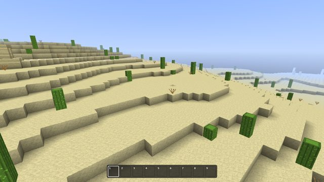 | 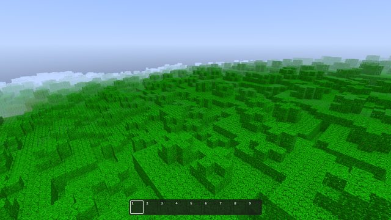 | 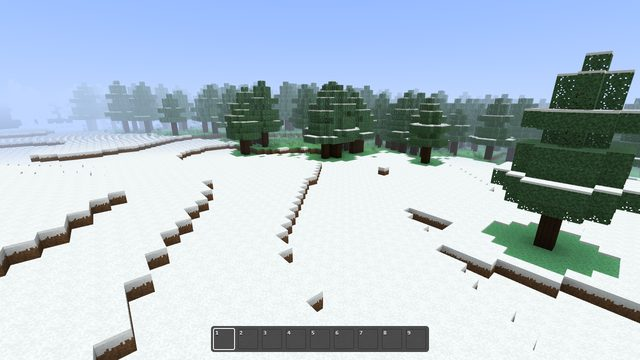 |
| Desert | Jungle | Snowy plains |
| 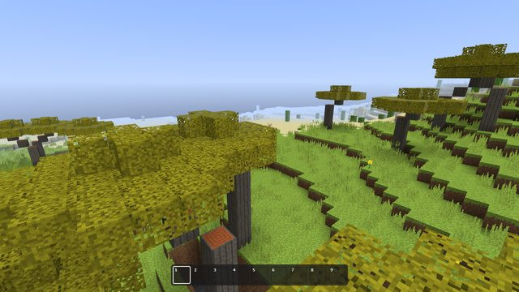 | 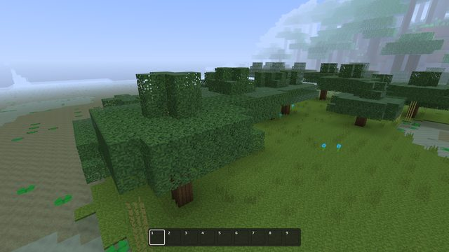 | 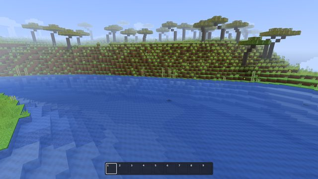 |
| Savanna | Swamp | River |

Grass, leaves and water take the colors of their biome, blended from one biome into the next. Water runs
downhill and pools; lava meeting it turns to cobblestone or obsidian.

| | | |
| --- | --- | --- |
| 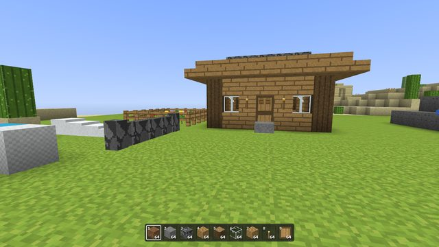 | 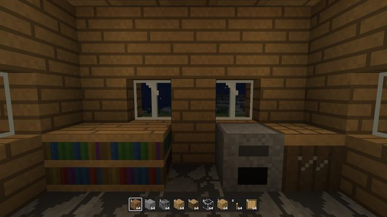 | 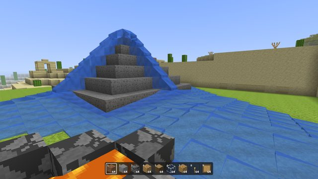 |
| Building | Torchlight at night | Flowing water |

## Survival and creative

A survival world starts with nothing. Break a tree by hand for logs, make planks and a crafting table in
the inventory's 2×2 grid, then sticks and a wooden pickaxe at the table's 3×3 grid; stone needs a pickaxe
to drop anything, iron ore a stone one, diamonds an iron one. Tools wear out. A furnace smelts ores, sand
and logs with coal, charcoal or wood; a chest holds 27 stacks, two side by side 54. Items move as in
Minecraft: the left button picks up and puts down stacks, the right one halves a stack or puts down one,
shift moves a stack across, a double click gathers. About a hundred recipes: planks, sticks, tables,
furnaces, chests, torches, tools and armor in every material, doors, stairs, slabs, panes, ladders, fences,
walls and more. (Health, hunger and armor that protects come next, in Phase 6.)

| | |
| --- | --- |
| 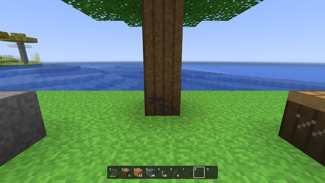 | 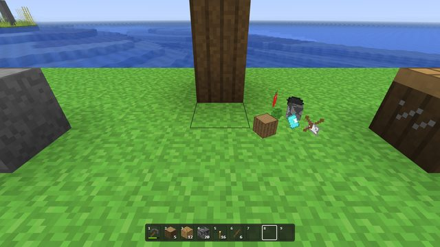 |
| Breaking takes time: cracks show how far along | What breaks drops, and is picked up by walking over it |
| 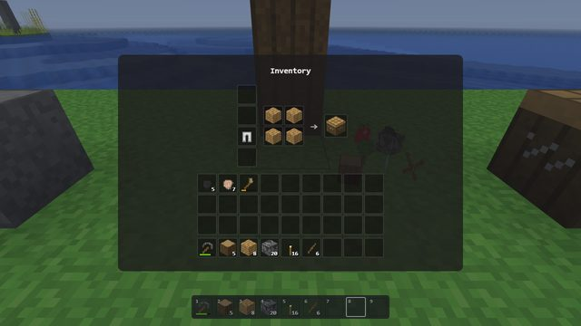 |  |
| The inventory and its 2×2 crafting grid | A furnace at work |

Worlds from before game modes open in creative, as they were played.

## Worlds and saves

Worlds are kept in the browser (IndexedDB): every chunk you've been near with what its chests and furnaces
hold and the items lying in it, the player and their inventory, the guests who played in it, and the
world's clock. Craft saves every 30 seconds, when you open the game menu or switch tabs, and when you quit
to the title. A world open in one tab can't be opened in a second one. From the title screen you can
rename, copy and delete worlds, and export one to a `.craftworld` file (or import such a file), to keep it
elsewhere or move it to another browser. Options (render distance, field of view, mouse sensitivity,
renderer, your name) are kept in the browser too.

## Playing with friends

Any world can be opened to friends from its game menu ("Open to friends…"): Craft shows a six-letter code
and a link to send. Friends open the link (or "Join a friend…" on the title screen and type the code), pick
a name, and play in the same world: they see each other, build and break together, share chests and
furnaces, and water flows for all.

| | |
| --- | --- |
| 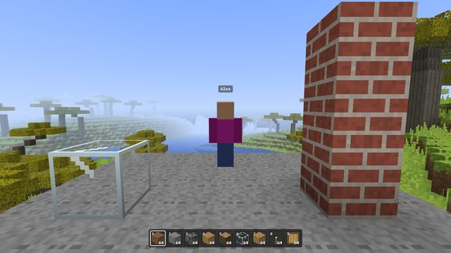 | 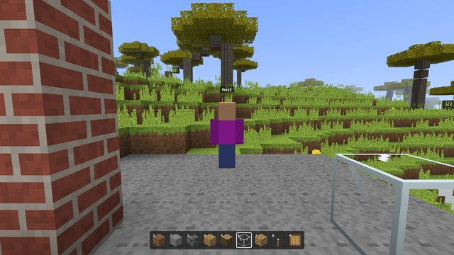 |
| The host's screen | The guest's screen |

The browser that opened the world hosts it. Everything happens there as in a single-player game: the
world is made, ticked and saved in that browser, guests' places and inventories included. Guests' browsers
connect to it directly (WebRTC), so the game's traffic goes nowhere else; the world stays open while the
host's tab is open.

Players are introduced to each other by two small endpoints next to the game, `/api/signal` and
`/api/ice` (in `api/`). `npm run dev` and `npm run preview` serve them too: started with
`npm run dev -- --host`, friends on the same network can join a world played from
`http://<your computer's address>:5173`.

### On Vercel

Deploying the repository to Vercel serves the game (a static Vite build) and the endpoints (as Vercel
Functions) on your domain. The functions need somewhere to keep the introductions between calls:

1. Add **Upstash Redis** to the project from the Vercel Marketplace (the free plan is plenty). It sets
   `KV_REST_API_URL` and `KV_REST_API_TOKEN` (or `UPSTASH_REDIS_REST_URL` and `UPSTASH_REDIS_REST_TOKEN`),
   which the functions read.
2. Optionally, for players on networks that block direct connections (some mobile and office networks):
   create a TURN key in Cloudflare's dashboard (Realtime, TURN; 1,000 GB a month are free) and set
   `CLOUDFLARE_TURN_KEY_ID` and `CLOUDFLARE_TURN_KEY_API_TOKEN`. Without them, connections use STUN only,
   which works for most home networks.

A join takes one offer and one answer through the functions; the host's open world polls them every 1.5
seconds while it is open. A deployed Craft uses its own textures: Minecraft's stay on the computer they
were imported on.

## How it works

Craft is TypeScript in the browser, on Projector, a small 3D engine with a WebGL 2 and a Canvas 2D
renderer. The simulation (the world, ticks, block updates, fluids, items) keeps away from the page and
the renderer, so the same code runs alone, as a host, and in the tests.

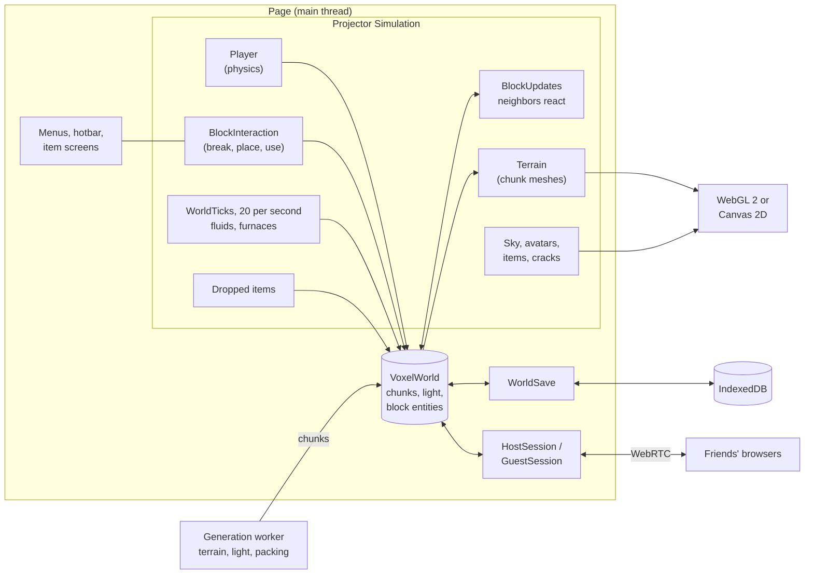

### A chunk's life

Chunks are 16 × 256 × 16 blocks in sixteen sections of 16³ block states. New ones are made in a worker
and arrive lit and packed for saving, so the main thread only puts them in place; a chunk is meshed when
it comes into view and again when a block in it (or next to it) changes.

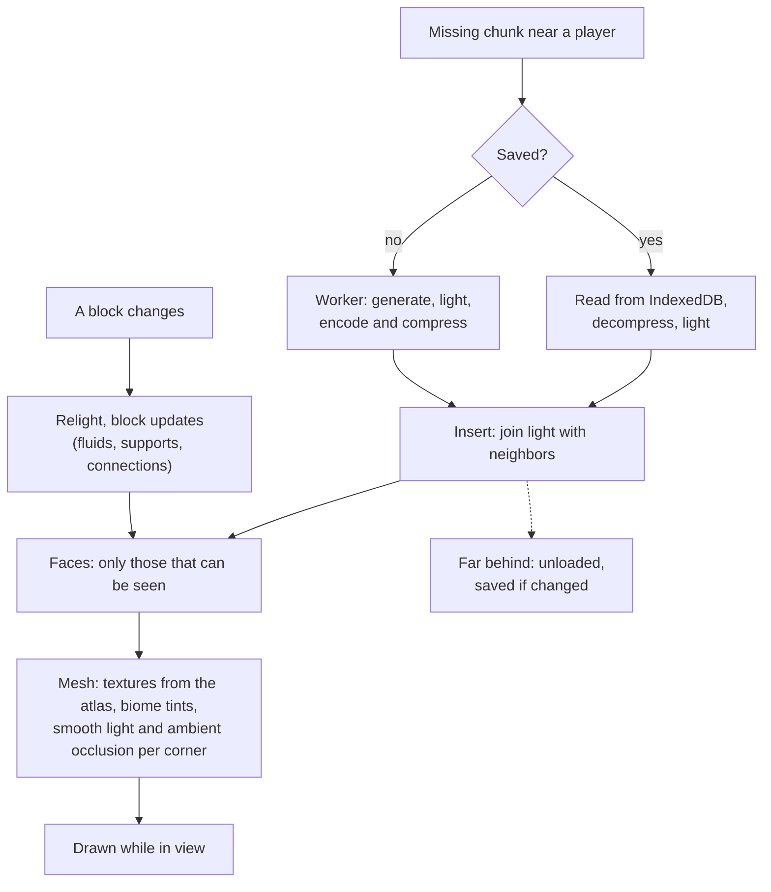

### Terrain

Terrain follows Minecraft 1.18's approach: climate noises shape the land and choose the biomes, and a 3D
density decides what is solid. Every step depends only on the seed and the position, so chunks match
across their borders whatever order they are made in.

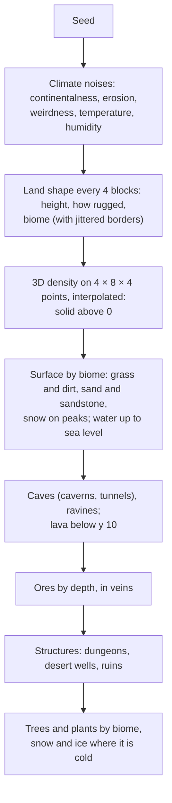

### Joining a friend

The host's browser is the server. The endpoints only introduce the two browsers; everything after goes
over a WebRTC data channel between them.

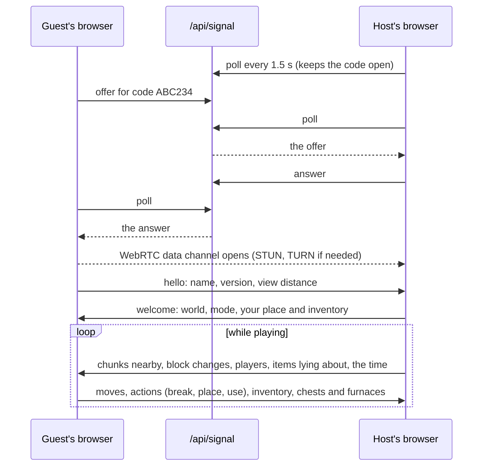

## Renderers

By default Craft draws with Projector's `WebGLBackend`: every chunk is a mesh of its own with textured
blocks, leaves you can see through and translucent water, at a 96-block view. Without WebGL2, or with the
Canvas 2D renderer chosen in Options, it draws with Projector's Canvas 2D renderer: flat-colored blocks at 48
blocks.

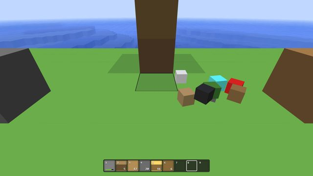

URL options: `?seed=` plays a fresh world with that seed that isn't saved (Quick play, in survival, or
creative with `&mode=creative`); `?view=16..160` and `?renderer=canvas|webgl` override the options for one
page; `?textures=craft` uses Craft's own textures even where Minecraft's were imported.

## Minecraft's textures

Craft paints its own pixel-art textures. To play with Minecraft's instead, import them from your own
installation:

```sh
npm run textures                    # the newest release in your .minecraft folder
npm run textures -- <file>          # a client jar or a resource pack zip
```

This copies the block and item textures Craft needs (water and lava animated, the chest from its model's
texture, the cracks of breaking), and the sun, the moon's phases and the clouds, into `textures/minecraft/`.
They belong to Mojang, so they stay on your machine: git ignores the folder and `npm run build` leaves it
out (a built Craft always uses its own textures). Delete the folder to go back to them.

## Project

- `src/`: the game. `docs/roadmap.md`: the plan, phase by phase, with what each one turned out to be.
- `api/`: the multiplayer endpoints (Vercel Functions, also served by the dev server).
- `tests/`: Vitest, run by `npm test`; `tests/fixtures/` holds a saved world of every save format, which
  must keep opening.
