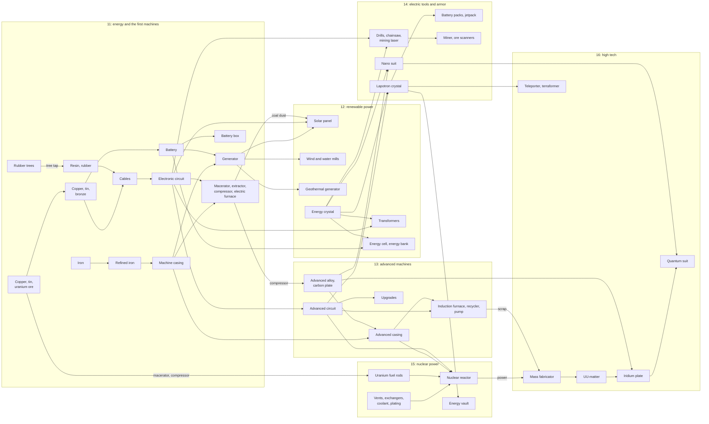

# Craft roadmap

A plan for giving Craft Minecraft's principal features, save games included, and then a technology tree
after the IndustrialCraft mods (added on 2026-10-23). Written on 2026-10-22 against `feature/textures`
(7a6fdea).

- [Where Craft stands](#where-craft-stands) and the [principles](#principles) every phase follows
- [1. Feature inventory](#1-feature-inventory): Minecraft's features, what Craft has, and the phase for the rest
- [2. Phases at a glance](#2-phases-at-a-glance) and [3. the phases](#3-phases) in build order, the
  [industry's technology tree](#industry-a-technology-tree-phases-11-to-16) among them
- [4. What Projector needs](#4-what-projector-needs): rendering features that belong in the framework
- [5. Decisions](#5-decisions)

## Where Craft stands

- Seeded, endless heightmap terrain 64 blocks high: oceans with sand beaches, stone cliffs, coal, iron and gold
  in the stone, bedrock, oak trees.
- 14 block types, one byte per block, no block states (orientation, levels). Water stands still.
- Walking, sprinting, jumping, swimming and climbing out of water, with box collision against full blocks.
- Breaking and placing instantly within 6 blocks, from a 9-slot hotbar of blocks.
- WebGL: a textured mesh per chunk, cut-out leaves, translucent water, a 96-block view at 60 fps. A Canvas 2D
  fallback with flat colors. Minecraft's own textures when imported (`npm run textures`).
- **Nothing is saved:** a reload starts the world over. Chunks are never unloaded either, so a long walk grows
  memory without bound.

## Principles

- **Every phase ends playable**, with `npm run check` green and no half-wired features left in between.
- **Saves come early.** From Phase 1 on, each feature that adds state (inventories, time, mobs) adds it to the
  save format in the same phase, under a format version with a migration.
- **Data, not code paths.** Blocks, items, recipes and mobs are registry entries with properties; behavior is
  small handlers attached to them.
- **Headless tests** for every system, like `tests/water.test.ts`: the world, ticks, physics, AI and saves run
  in Node without a DOM. This also keeps the simulation movable to a worker, or a server one day.
- **A performance budget:** 60 fps at the default view, and no frame over 16 ms from chunk work while moving.
  Measured in Chrome at the end of each phase (standing still, and flying at 25 blocks/s).
- **Mojang's assets stay local.** Textures today, and sounds and entity textures later, are imported from the
  player's own installation into git-ignored folders and never bundled. Craft always has fallbacks of its own.
- **Projector grows where it's general.** Rendering any 3D app could use (vertex colors, light maps, sky) goes
  into Projector as requirements; Minecraft's rules stay in Craft.

## 1. Feature inventory

✓ have · ◐ partly · a number is the phase that adds it · L later · — not planned

| Area | Minecraft feature | Craft today | Phase |
| --- | --- | --- | --- |
| World | Endless seeded terrain | ◐ heightmap hills, mountains, oceans | 4 (3D shapes, overhangs) |
| | Build height | 0–63 | 0 (0–255) |
| | Biomes | — | 4 (about 15) |
| | Caves, ravines, aquifers | — | 4 |
| | Ores by depth | ◐ coal, iron, gold | 4 (+ copper, redstone, lapis, diamond, emerald) |
| | Trees and plants | ◐ oak | 4 |
| | Structures | — | 4 (dungeons, wells), L (villages) |
| | Nether, End | — | L, — |
| Blocks | Block types (about 1,000 in Minecraft) | 14 | 3 (about 60), then as needed |
| | Block states: orientation, levels, halves | — | 0 |
| | Shapes: slabs, stairs, fences, doors, torches, plants | — | 3 |
| | Cut-out and translucent blocks | ◐ leaves, water | 3 |
| | Flowing water and lava | ◐ still water | 3 |
| | Falling sand and gravel | — | 3 |
| | Animated textures (water, lava) | — | 3 |
| | Crafting table, furnace, chest, bed, door, ladder | — | 3, 5, 6 |
| Light and sky | Sky light and block light, levels 0–15 | — (sun shading only) | 2 |
| | Smooth lighting, ambient occlusion | — | 2 |
| | Day and night, sun, moon, stars, clouds | — (always noon) | 2 |
| | Rain, snow, thunderstorms | — | 9 |
| Player | Walk, sprint, jump, swim | ✓ | |
| | Sneak, climb ladders, fly in creative | — | 8, 3, 6 |
| | Mining with break times and cracks | ◐ instant | 5 |
| | Placing with orientation | ◐ cubes only | 3 |
| | Hand, held item, third person | — | 8 |
| Items | Inventory: 36 slots, armor, off-hand | ◐ 9-slot block hotbar | 5 |
| | Crafting 2×2 and 3×3 | — | 5 |
| | Tools in tiers, durability | — | 5 |
| | Smelting | — | 5 |
| | Food, armor | — | 6 |
| | Enchanting, anvils, brewing | — | L |
| Survival | Health, damage, death, respawn | — | 6 |
| | Hunger and saturation, air and drowning | — | 6 |
| | Experience | — | 6 |
| | Game modes, difficulty | — (creative-like) | 6 |
| Mobs | Passive animals | — | 7 |
| | Monsters spawning in the dark | — | 7 |
| | AI and pathfinding | — | 7 |
| | Combat: melee, bows, knockback, explosions | — | 7 |
| | Breeding, taming | — | 9, L |
| | Slimes | — | 10 |
| | Villagers and trading | — | L |
| Simulation | Game ticks: scheduled and random | — | 0 |
| | Growth, spreading, leaf decay, farming | — | 9 |
| | Redstone | — | 9 (basics), 10 (pistons, hoppers, comparators), L |
| | Fire | — | L |
| | Boats, minecarts, horses | — | L |
| Industry (beyond Minecraft) | Energy: generators, cables, transformers, stores | — | 11, 12 |
| | Machines: macerator, extractor, compressor, electric furnace | — | 11 |
| | Solar, wind, water and geothermal power | — | 12 |
| | Advanced machines, upgrades, automation | — | 13 |
| | Electric tools, jetpack, nano suit, the miner | — | 14 |
| | Nuclear reactors | — | 15 |
| | UU-matter, quantum suit, teleporters, terraformers | — | 16 |
| Saves and UI | Several worlds, saving, autosave | — (lost on reload) | 1 |
| | Title, world list and pause menus | ◐ start overlay | 1 |
| | Settings and key bindings | ◐ URL parameters | 1, 8 |
| | HUD: hearts, hunger, air, XP | ◐ hotbar | 6 |
| | Debug screen (F3) | — (removed on request) | 8 (hidden until F3) |
| | Chat and commands | — | 8 |
| | Sound and music | — | 8 |
| | Particles | — | 8 |
| | Signs, books, maps, paintings | — | L |
| | Advancements, statistics | — | — |
| | Multiplayer | — | — (see decision 4) |
| Rendering | Textured blocks | ✓ (Minecraft's when imported) | |
| | Render distance | ✓ 96 blocks, up to 160 | |

## 2. Phases at a glance

| Phase | Theme | Size | Needs |
| --- | --- | --- | --- |
| 0 | Foundations: block states, taller chunks, unloading, ticks, entities, a generation worker | L | |
| 1 | Worlds and save games | M | 0 |
| 2 | Light, day and night, sky | L | 0; Projector R12–R14 |
| 3 | Block shapes, more blocks, fluids | L | 0, 2 |
| 4 | Terrain 2.0: biomes, caves, structures | L | 3 |
| M | Multiplayer: friends join a host's session | L | 4 |
| 5 | Items, inventory, crafting, tools | L | 3 |
| 6 | Survival and game modes | M | 5 |
| 7 | Mobs and combat | L | 6 |
| 8 | Feel: sound, particles, hand, camera, UI | M | parts any time |
| 9 | Farming, weather, redstone basics | L | 5, 7 |
| 10 | Pistons, hoppers and comparators | M | 9 |
| 11 | Industry I: energy, cables, the generator and the first machines | L | 9, 10 |
| 12 | Industry II: solar, wind, water and geothermal power; transformers | M | 11 |
| 13 | Industry III: advanced machines, upgrades, automation | L | 12 |
| 14 | Industry IV: electric tools and armor, the miner | M | 12 |
| 15 | Industry V: nuclear power | L | 13, 14 |
| 16 | Industry VI: UU-matter, quantum suit, teleporters, terraformers | M | 15 |
| L | Later: Nether, enchanting, brewing, villagers, transport | | |

Sizes are relative effort (S, M, L), not dates. Each phase is planned in detail when it starts.

## 3. Phases

### Phase 0: Foundations (L)

**Done on 2026-10-22.** What changed against the plan below:
- Faces are built per section, but meshes stay one per chunk column: rebuilding a column's mesh from its
  sections' faces takes 0.2 ms, and it keeps the draw calls where they were (61 at a 96-block view).
- A section of nothing but opaque blocks is scanned only on its outer layer, so face building stays at
  0.4 ms per chunk on the four times taller world (0.39 ms before).
- The registry has only the properties something uses so far (solidity, opacity, shapes, looks, the log's
  axis); hardness, tools, drops and light come with the phases that use them.
- Logs already lie along the face they're placed against (from Phase 3), to put the states to real use.
- Entities don't belong to chunks yet: saving is the first thing that needs it, so it moves to Phase 1.
- Projector's R16 and R17 aren't needed yet: meshing stays on the main thread, and memory stays bounded.
- Measured in Chrome (RTX 5070): flying at 25 blocks/s, a median frame of 0.3 ms and at most 3.2 ms (3.8 ms
  before); at 50 blocks/s for 2,000 blocks, at most 4.8 ms, 210–217 chunks loaded all the way and a heap
  between 63 and 96 MB that doesn't grow. Generation takes about 2 ms per chunk, in the worker.

Everything later builds on these, and the save format (Phase 1) should be written against them instead of
migrating from today's format.

- **Block registry and states** (`src/blocks.ts`): every block is a named entry (`oak_log`) with its
  properties: solidity, opacity class (opaque, cut-out, translucent, none), hardness, tool and harvest level,
  drops, light emission and filtering, model, textures per face, sound group, gravity, replaceable, flammable.
  States (`oak_log[axis=x]`, `water[level=3]`) get dense numeric ids at startup and chunks store those. Saves
  store names, so ids can change between versions.
- **Chunk format v2** (`src/chunk.ts`, `src/world.ts`): `Uint16Array` state ids, 0–255 high in 16 sections of
  16³, sea level 63. Per-section block counts make empty sections free; light arrays per section are filled
  in Phase 2. `world.get` and `world.set` keep their signatures; the generator scales to the new height.
- **Section meshing** (`src/chunkMesh.ts`, `src/terrain.ts`): faces and meshes per section, so an edit
  rebuilds 16³ blocks instead of the column, and the face packing loses its 6-bit height limit. If a draw call
  per section costs too much, sections of a column are merged into one mesh (measure first).
- **Chunk lifecycle:** generating, loaded, meshed, unloaded. Chunks beyond the load radius plus a margin are
  unloaded, after saving from Phase 1 on.
- **Generation in a worker** (`src/worker/`): the generator is a pure function of seed, generator version and
  chunk position, so it moves to a Web Worker as it is; block arrays come back as transferables, requested
  nearest first. Meshing stays on the main thread (0.5 ms per chunk today) unless measurements say otherwise.
- **Game ticks** (`src/ticks.ts`): Minecraft's 20 ticks per second, on top of Projector's fixed steps.
  Scheduled ticks (fluids, falling blocks, redstone) in a queue ordered by tick and insertion; random ticks
  (3 random blocks per section per tick) for growth and decay. Deterministic, so tests can step them.
- **Entities** (`src/entity.ts`): the player's box physics (`moveAxis`, gravity, water) becomes an `Entity`
  base shared by the player, dropped items, falling blocks and mobs. Entities belong to the chunk they are in,
  for saving and unloading.
- **Block shapes in collision and picking** (`src/collision.ts`, `src/raycast.ts`): blocks report boxes (a
  full cube by default), so slabs, stairs, doors and plants can collide and be targeted precisely.
- **Done when:** today's game plays the same on the new format at 256 blocks high; memory stays flat flying
  2,000 blocks; walking costs no more frame time than today; generation runs in the worker.
- **Tests:** state ids round trip by name; v2 get and set across sections; the worker and the main thread
  generate identical chunks; tick ordering; today's collision tests on the entity base.

### Phase 1: Worlds and save games (M)

**Done on 2026-10-22.** What changed against the plan below:
- Each world plays in a page of its own (`?world=<id>`); quitting loads the title page. That frees the WebGL
  context, the worker and every listener without teardown code, for about a second of loading.
- New chunks come from the worker already encoded and compressed for saving, so a save only encodes chunks
  the player changed on the main thread. Before that, the first save of a new world blocked for 45 ms (168
  chunks); now 0.2 ms, 8 ms in all, and no frame runs long.
- A saved chunk takes about 0.9 KB (the estimate was 10 KB): a world explored for a while is a few MB.
- Chunk records don't hold entities yet. The first entity that must be saved (falling blocks, Phase 3) adds
  them, with a format bump, a migration and a fixture.
- Game mode, difficulty and weather join the world's record with the phases that add them.
- The store is tested on IndexedDB itself (`fake-indexeddb` in Node), and `tests/fixtures/format-1.craftworld`
  is the first saved-world fixture.

- **Menus** (DOM, `src/ui/`): a title screen and a world list showing name, seed, last played and size.
  Create a world (name and seed; game mode from Phase 6), play, rename, duplicate, delete (with a
  confirmation), export to a file and import one. Esc opens a pause menu: back to game, options, save and quit
  to title. `?seed=` stays as a quick way into a fresh world.
- **Entities in chunks:** an entity is saved and unloaded with the chunk it stands in (moved here from
  Phase 0, then on to Phase 3: see above); the player is saved apart.
- **Store** (`src/save/`): a `WorldStore` interface, implemented on IndexedDB for the browser and in memory
  for tests. The IndexedDB database `craft` holds:
  - `worlds`: id, name, seed, format version, generator version, created and last played, game mode,
    difficulty, time of day, weather, world spawn.
  - `players`, one per world: position, rotation, velocity, health, hunger, air, XP, inventory, selected slot,
    game mode, spawn point. Each field arrives with the phase that adds it.
  - `chunks`, keyed by world and position: a palette of state names, blocks as indices into it (8 or 16 bits),
    light, block entities (chest contents, furnace progress), entities, pending scheduled ticks, and the
    generator version that made it. Compressed with `CompressionStream("deflate-raw")`, which Node has too.
- **Which chunks are saved:** every generated chunk, as in Minecraft. Saving only edited chunks is smaller,
  but a changed generator would then regenerate untouched land differently, with seams around every edit.
  The size per chunk is to be measured in this phase (estimated around 10 KB).
- **When:** edits mark chunks unsaved. An autosave every 30 seconds writes the unsaved chunks, the player and
  the world metadata in one transaction; so do pausing, quitting, unloading a chunk and, as far as the browser
  allows, hiding the tab. Closing the tab loses at most the time since the last autosave.
- **Safety:** `navigator.storage.persist()` is requested at the first save so the browser doesn't evict worlds
  when space runs low; a Web Lock per world stops two tabs from writing the same world; the format version
  comes with migrations, tested against a saved fixture of every older version.
- **Export file** (`.craftworld`): a small binary container (magic number, version, a JSON header with the
  metadata, the player and a chunk index, then the chunk records), downloaded on a click and imported through
  a file picker.
- **Settings** (render distance, renderer, FOV, mouse sensitivity, later volume and key bindings) move to
  `localStorage`; the URL parameters remain as overrides.
- **Done when:** after building something and reloading, everything is where it was, the player included; two
  worlds stay independent; export, delete and import give back the same world.
- **Tests:** chunk and player serialization round trips, the store contract on the memory store, migrations
  from fixtures, autosave timing with a fake clock.

### Phase 2: Light, day and night, sky (L)

**Done on 2026-10-22.** What changed against the plan below:
- Saves don't keep light: it follows from the blocks. The worker lights every chunk it generates on its own,
  a saved chunk is lit as it's read (0.2 ms), and a chunk's light is joined with its neighbors' when it
  enters the world. A test checks that light after hundreds of random edits equals the light of the same
  blocks lit from scratch.
- Missing chunks count as dark, so no light leaks in from the edge of the loaded world.
- Projector got R12-R14 (corner colors, a second UV set with light maps, materials outside fog and depth,
  additive blending) in version 0.4.0. Terrain is unlit by the scene's lights: face shading and ambient
  occlusion are in the corner colors, light levels in the second UVs, and the day in the light map.
- Canvas 2D shades each face by the light in front of it (8 steps, warmer where torches light it more than
  the sky) and follows the day through fog and background; it has no sky objects, as decided.
- Light filters: leaves and water dim light by one more level per block than air; water is dark below
  about seven blocks.
- Measured in Chrome: meshing takes 0.42 ms per chunk (0.17 before, for the light and occlusion per
  corner); flying at 25 blocks/s, at most 5.8 ms a frame (3.2 before), at 50 blocks/s 7.1 ms; 60 fps
  throughout. Canvas 2D: 60 fps, 2.9 ms a frame.

- **Light levels** (`src/light.ts`): sky light (15 straight down from the sky, 1 less per block sideways and
  through leaves or water) and block light from emitters (torch 14, glowstone and lava 15), 0–15 per block in
  the section light arrays. Flood-filled when a chunk is generated (in the worker) and updated on edits with
  the usual add and remove queues, across chunk borders.
- **First light sources:** torches (on the floor and on walls, a small model of their own) and glowstone.
- **Smooth lighting and ambient occlusion** (`src/chunkMesh.ts`): each face corner gets the average light of
  the four blocks around it and an occlusion factor from the three neighbors that can shade it. This needs
  per-corner data in Projector meshes (R12, R13).
- **Day and night:** a 20-minute day (24,000 ticks), saved with the world. Light reaches the shader as levels;
  a light map (a 16×16 texture indexed by block light and sky light, R13) turns them into brightness and is
  recomputed as the time changes, so night falls without remeshing anything. The directional sun light
  follows the sun; sky color, fog color and the hemisphere light follow the time.
- **Sky:** a gradient, the sun and the moon with its phases, stars at night and drifting clouds, as unlit
  meshes that move with the camera and ignore fog (R14). They use `environment/sun.png`, `moon_phases.png`
  and `clouds.png` when imported, and drawn ones otherwise.
- **Darkness:** caves and deep water get dark from light levels instead of today's fixed fog.
- **Done when:** a torch in a cave lights a round area that falls off level by level; the sun sets and rises;
  night is dark and starry; nothing remeshes as time passes.
- **Tests:** sky light under an overhang, a torch placed and removed, light across a chunk border, light-map
  values over a day.

### Phase 3: Block shapes, more blocks, fluids (L)

**Done on 2026-10-22.** What changed against the plan below:
- Models are in `src/shapes.ts`: every state's quads (from boxes, or crossed planes) are built once at
  startup, with its collision and selection boxes. Which sides a state covers (for culling) is rasterized
  from its quads; which sides are sturdy (for torches, plants and fence connections) from its collision
  boxes, so glass and leaves hold torches as in Minecraft while hiding nothing.
- Block updates (`src/updates.ts`): a change updates the block and its six neighbors, as in Minecraft:
  fences, panes and walls connect, stairs take their corner shapes (Minecraft's rule), blocks that lose
  their support come off (a door's two halves together), and fluids and sand are scheduled to move. As in
  Minecraft, a block only checks its support when a neighbor changes, not when it is put in place.
- 82 blocks: the shapes in oak, stone, cobblestone, brick and stone brick, 16 colors of wool and carpet,
  gravel, glass, ice, snow, clay, obsidian, crafting table, furnace, bookshelf, ladder, lava, flowers, short
  grass, a sapling and cactus. The chest and the bed wait for what they're for (Phases 5 and 6); fence gates,
  stained glass and farmland (Phase 9) for later.
- Fluids follow Minecraft's spreading code closely, down to its quirks: a source in midair spreads a block to
  each side before falling, so it makes a plus-shaped waterfall. Flowing water uses the still texture on its
  sloped surface (no `water_flow` yet). Currents push the player; lava is slower to move in than water.
- Sand and gravel fall by scheduled ticks (a block a tick, 20 a second) instead of as entities: no falling
  animation yet, but nothing to save between ticks.
- Light gets into slabs and stairs but not through them (Minecraft's light occlusion by shape, simplified),
  so their faces and the faces next to them aren't black, and a slab roof keeps the house below dark.
- Ladders came from Phase 8: climbing while pushing into them or holding Space, sliding down slowly otherwise.
- E opens a list of all blocks to put one into the hotbar, and the middle button picks the block aimed at.
  The hotbar is saved: save format 2, with a migration that gives older players the default hotbar and a
  fixture of its own.
- Measured in Chrome: meshing 0.47 ms per chunk (0.42 before); flying at 25 blocks/s at most 5.1 ms a frame,
  at 50 blocks/s 5.6 ms; 60 fps throughout. Canvas 2D: 60 fps, 3.4 ms a frame, every shape drawn, fluids
  flat per block.

- **Models** (`src/models.ts`): a block model is a list of boxes with textures and UVs per face, plus culling
  rules (a face is hidden only by a neighbor that covers it completely). Shapes: cube, cross (flowers, tall
  grass, saplings), torch, slab (bottom, top, double), stairs (with corner shapes), fence and wall
  (connecting), glass pane, door (two blocks, opens), trapdoor, ladder, carpet, snow layer, cactus, farmland.
- **Placement:** logs along the clicked axis, stairs and doors facing the player, top or bottom slabs by where
  the face was hit, torches on walls. The right button opens doors, trapdoors and gates.
- **Transparency:** opaque; cut-out (leaves, glass, plants: alpha-tested in the solid mesh); translucent
  (water, ice, stained glass: the sorted translucent mesh).
- **About 60 blocks:** the shapes above in oak, stone, cobblestone and brick; gravel, glass, colored wool,
  ice, snow, clay, obsidian, glowstone, crafting table, furnace, chest, bed, ladder.
- **Fluids:** water and lava with levels (a source plus 7 flowing levels for water, 3 for lava), falling
  columns, Minecraft's spreading rule (toward the nearest way down within 4 blocks), new water sources between
  two sources, and lava meeting water turning into obsidian, cobblestone or stone. Sloped surfaces from the
  corner heights, flowing textures, currents that push entities. Water updates every 5 ticks, lava every 30.
- **Animated textures:** water and lava frames, by updating their atlas tiles (`Texture.markDirty`).
- **Gravity blocks:** sand and gravel fall as entities and land as blocks.
- **Done when:** a house of planks, stairs and slabs with glass windows and a door; a torch-lit room; water
  poured on a hill runs down and pools; lava meeting water makes cobblestone.
- **Tests:** culling between shapes, placement states, fluid spreading stepped tick by tick on fixed layouts,
  falling blocks.

### Phase 4: Terrain 2.0 (L)

**Done on 2026-10-22.** What changed against the plan below:
- 18 biomes: the 15 planned and dark forest, frozen river and frozen ocean. Climate is sampled at density
  points 4 blocks apart (as Minecraft's biomes are) and each column takes a nearby point's biome with a
  little jitter, so borders aren't square. Chunks store a biome per column (save format 3); chunks from
  before are plains, as they were made.
- Biome colors blend over 6 x 6 columns around each corner. Grass, leaves, ferns, sugar cane and water are
  stored gray (Minecraft's own are) and colored per corner by the mesh; birch and spruce leaves and lily
  pads have fixed colors. Grass block sides get Minecraft's tinted overlay as a second quad, drawn over the
  first (WebGL's depth test lets the second through). Snow on grass shows on its sides (`snowy`).
- Shape: Minecraft's density on 4 x 8 x 4 points, interpolated, from splines of the climate: coasts, hills,
  rivers in valleys, mountains with cliffs and overhangs up to about y 235, swamps at the water line.
- Caves: noise caves only (caverns and tunnels, some opening to the surface) and noise ravines instead of
  carvers, so they meet across chunk borders by construction; lava below y 10. **No aquifers:** caves are
  dry, and are kept from touching the sea and rivers so these don't drain into them.
- Ores by depth as measured over 24 land chunks: coal (median y 59), copper (48), iron (35), gold (17),
  redstone and lapis low, diamonds below 16 at about 4 per chunk, emeralds single in mountains. No
  deepslate.
- Trees: oak, big oak, swamp oak, birch, spruce, jungle (and 2 x 2 giant ones), acacia, dark oak (2 x 2).
  Plants: grass, tall grass, ferns, large ferns, eight flowers, dead bushes, cacti, sugar cane by water,
  lily pads on swamps, pumpkins. Snow on cold ground and on peaks above y 150, ice on cold water. No vines
  or cocoa yet.
- Structures: dungeons (with a spawner; the chest comes with Phase 5's inventories), desert wells, ruins of
  old stone. Trees don't grow through them.
- 121 blocks: five more woods (log, leaves, planks), sandstone, five ores, mossy and cracked stone,
  spawner, the plants above. Tall grass and large ferns are two-high like doors.
- Measured in Chrome: generating takes 1.5 ms per chunk in the worker, which kept every chunk in view
  loaded flying at 44 blocks/s; meshing 0.96 ms per chunk (0.47 before: tints, overlays, cave faces);
  frames at most 8.7 ms flying; Canvas 2D 60 fps at 7.9 ms (more plants to draw).

- **Climate and biomes** (`src/gen/`): noise for temperature, humidity, continentalness and erosion picks a
  biome per column: ocean, deep ocean, beach, river, plains, forest, birch forest, taiga, snowy plains,
  desert, savanna, jungle, swamp, stony mountains, snowy peaks. Each brings surface rules, vegetation and tint
  colors; tints blend over 5×5 columns into the per-corner colors (R12).
- **Shape:** 3D density noise instead of a heightmap, for overhangs and steep mountains up to about y 200.
- **Underground:** cheese and spaghetti caves, ravines, lava pools below y 10, aquifers; ores by depth and in
  veins (coal, copper, iron, gold, redstone, lapis, diamond, and emerald in mountains).
- **Features:** trees by biome (oak, birch, spruce, jungle, acacia, dark oak, big oaks), tall grass, flowers,
  ferns, cacti, dead bushes, sugar cane, pumpkins; snow on cold ground and ice on cold water.
- **Structures:** placed on a seeded grid that reaches across chunk borders (as trees do today): dungeons with
  a spawner and a chest, desert wells, small ruins. Villages come later.
- **Old worlds:** new chunks use the new generator, with seams at the old border, as in Minecraft.
- **Done when:** a walk crosses several biomes with smooth transitions; caves open to the surface; diamonds are
  rare and deep; the worker keeps up with flying at sprint speed.
- **Tests:** determinism per seed, every biome appearing within a fixed area, ore depth histograms, structures
  across chunk borders.

### Phase M: Multiplayer (L)

**Done on 2026-10-22.** What changed against the plan below:
- Guests do their own actions at once with the same rules as the host (`src/actions.ts`, shared with
  single player) and send them; the host does them again after checking reach, the block and that the
  face is real, and sends what really is there to every guest, the actor included, putting right a guess
  it refused. Movement is the guest's own (not checked beyond being numbers), as Minecraft's servers do
  only loosely.
- The host sends chunks in the packed form saves use, nearest first, a few per frame and only while the
  data channel's buffer is low; a guest tells the host which chunks it let go of. Block changes in the
  chunks a guest has go out once a frame, after any chunk still being compressed for them.
- Host and guest check they run the same Craft: the protocol version and a fingerprint of all block states
  (states travel as ids).
- Signaling: `/api/signal` (mailboxes per world code, one offer and one answer per join, no trickle ICE)
  and `/api/ice` (STUN, and Cloudflare TURN credentials when a key is set), one module run by Vercel
  Functions with Upstash Redis and by the Vite dev and preview servers in memory.
- Guests are saved by the host: save format 4 and a `guests` store (IndexedDB version 2, created on
  upgrade); `.craftworld` files carry them. Quick-play worlds keep returning guests' places until the page
  closes.
- Other players are figures of boxes in a shirt color of their own, lit by the light where they stand,
  with name tags; joins and leaves are noticed. The player's name is in Options, asked for on the first
  join; a random id kept in the browser says who comes back.
- Not done: copy-and-paste invites without any server (a deployment needs its functions), and importing
  Minecraft's textures in the browser (guests on a deployed game see Craft's own).
- Measured in Chrome, two browsers on one computer over WebRTC: a guest joined and had 151 chunks in 3.2
  s; while it flew at 20 blocks/s for 10 s it never missed a chunk within 4, and the host's frames stayed
  at a median of 1 ms and at most 3.3 ms.

Asked for after Phase 4 was planned: friends play in one world, hosted by one of them, with nothing to run
but the game. Proposed to come right after Phase 4, so items, mobs and survival are built for it from the
start rather than fitted to it later.

- **The host's browser is the server.** The host plays as usual; generation, ticks, fluids, block updates
  and saves run there, as now. "Open to friends" gives an invite link (`<domain>/?join=<code>`).
- **Clients** show the host's world: they receive chunks in the packed form saves use (biomes and all),
  block changes as they happen, other players and the time, and send their position and actions (break,
  place, use). The host checks actions against reach and rules before applying them. Movement is predicted
  locally and corrected by the host.
- **Transport:** WebRTC data channels, browser to browser. Introductions (signaling) go through a small
  function next to the static game (Vercel), a few kilobytes per join; STUN finds the way through home
  routers, and a TURN relay (Cloudflare's free tier) is used where that fails. Game traffic never touches
  the deployment. A copy-and-paste invite works without any server.
- **Saves:** player records per player id in the host's world (format change); the world lives in the
  host's browser, and the session ends when the host closes it.
- **Textures:** a deployed game can't serve Minecraft's textures; each player may import their own into
  their browser instead of `npm run textures`.
- **Done when:** two browsers on different networks build in the same world, see each other move, and the
  joining player's things are where they left them when they come back.
- **Tests:** a host and clients in one test over an in-memory transport: chunk sync, edits both ways,
  rejected actions, a client reconnecting.

### Phase 5: Items, inventory, crafting, tools (L)

**Done on 2026-10-23.** What changed against the plan below:
- A game mode per world came along (the start of Phase 6): survival gathers, breaks in time, drops and
  crafts; creative has every item at hand (E lists them, with a search), breaks at once and uses nothing
  up. New worlds pick one, older ones are creative (save format 5), quick play takes `&mode=creative`.
- Items (`src/items.ts`): every block, 25 materials and foods, 25 tools in five tiers (gold as fast as
  Minecraft's and as weak), 16 pieces of armor (worn in their slots; protection comes with health in
  Phase 6). Not yet: buckets, shears, flint and steel; beds and food came in Phase 6.
- Inventory (`src/inventory.ts`): 36 slots, 4 armor slots and an off-hand slot (kept, not used yet).
  Minecraft's clicks: pick up, put down, swap, halve, one at a time, shift to move across, double click to
  gather; not yet dragging to spread a stack.
- Crafting (`src/crafting.ts`): about a hundred shaped and shapeless recipes as data, with tags (any
  planks, any log, coal or charcoal), shapes matched anywhere in the grid and mirrored; 2 x 2 in the
  inventory, 3 x 3 at a crafting table; shift on the result crafts as many as fit. No recipe book.
- Mining (`src/mining.ts`): Minecraft's hardness, tool kinds and tiers and its break time formula, the
  drops of each block (ores give raw ore or gems, stone cobblestone, leaves now and then a sapling or an
  apple, double slabs two slabs), tools wearing a use per block. Cracks show the progress on WebGL.
- Dropped items (`src/drops.ts`): entities that fall, slide, merge with their kind, get picked up after a
  moment and go after five minutes; saved with their chunk. Block items show as spinning cubes with their
  textures, others as their picture.
- Block entities (`src/blockEntities.ts`): chests (27 slots, a double chest 54) and furnaces (fuel, 10 s per
  item, coal for 8, a lit front that gives off light), saved with their chunk; breaking one spills what it
  held.
- Icons: blocks drawn once into little cubes from their textures (`src/icons.ts`), items from Minecraft's
  item textures when imported (66 of them, and the chest from its model's texture), Craft's own drawings
  otherwise.
- Multiplayer (protocol 2): a guest's inventory is theirs (the host keeps it for their next visit); their
  breaks drop on the host's side for the tool they held; they see the items lying about, pick them up by
  asking, throw them; chests and furnaces are the host's, shown to the guest who opens them and changed by
  them. A guest sees only the half of a double chest they opened.
- Checked in the browser: the survival start played with the mouse (a log broken by hand, picked up,
  planks and a crafting table in the 2 x 2 grid, a pickaxe at the table), a furnace smelting and lit, a
  double chest, and a reload that kept the mode, the inventory with a worn pickaxe, the chest's contents and
  the items lying about; two browsers in one world with protocol 2; Canvas 2D at 60 fps. That found two
  bugs: chests side by side never joined into a double chest (`BlockUpdates` now pairs them, keeping a pair
  it has), and saved worlds and joins failed to open (the inventory drew the hotbar before it was made).

- **Items** (`src/items.ts`): every block as an item, plus materials (sticks, coal, ingots, diamonds, flint,
  string, leather), tools and food. Stacks of up to 64 (16 for some items, 1 for tools), tools with durability.
- **Inventory:** 36 slots (9 of them the hotbar), 4 armor slots and an off-hand. E opens the inventory screen
  with drag and drop, shift-click, splitting a stack with the right button and double-click to gather. Creative
  mode gets a searchable creative inventory with tabs.
- **Crafting:** shaped and shapeless recipes as data; 2×2 in the inventory, 3×3 at a crafting table. About 60
  recipes: planks, sticks, crafting table, furnace, chest, torches, tools in five tiers, doors, stairs, slabs,
  panes, ladders, beds, bread, armor.
- **Tools and mining:** break time from the block's hardness, the tool type and its tier (hardness × 1.5 s
  when the block can be harvested, × 5 s when it can't, divided by the tool's speed when it is the right kind
  of tool); blocks that need a tier drop nothing without it (stone needs a pickaxe); tools wear with use;
  cracks spread over the block being broken (`destroy_stage_*`).
- **Drops:** broken blocks drop item entities that bob and spin, merge with their neighbors, get picked up when
  the player comes near and disappear after 5 minutes.
- **Block entities:** chests (27 slots, 54 when double), furnaces (fuel and smelting: 10 s per item, coal for 8
  items), crafting tables. Their contents are saved with the chunk.
- **Icons:** blocks rendered once into small isometric images, items from `item/*.png` when imported, and
  drawn ones otherwise.
- **Done when:** in a new world, the Minecraft start works: wood, planks, crafting table, wooden pickaxe,
  stone, a furnace to smelt iron, a chest to store it, and a reload keeps all of it.
- **Tests:** recipe matching (shapes, mirrored shapes, shapeless), stacking and splitting, break times by
  tool, furnace progress over ticks, chest contents through a save.

### Phase 6: Survival and game modes (M)

**Done on 2026-10-23.** What changed against the plan below:
- Game modes per world: survival, creative (flying: a double tap of Space, Shift to go down, as Craft's
  sprint key is Shift) and hardcore (survival on hard, one life; after dying the player looks on as a
  spectator, flying through blocks). Chosen when the world is made; no switching in a world yet.
- Health (`src/vitals.ts`, `src/survival.ts`): Minecraft's rules. Falls (a point per block beyond three,
  half onto a bed, none into water or onto a ladder), drowning, lava (4, and burning for 15 seconds, put
  out by water), burning, suffocating, cactus and the void; half a second in which only a harder hit lands;
  a red flash, hearts that flash when hit and shake when nearly gone, flames on screen while burning. The
  death screen gives the cause and score; what the player carried and 7 points of experience per level
  (100 at most) fall where they died; they come back at their bed (beside it, if there's room) or the
  world's spawn. Creative takes only the void, spectators nothing. Fire blocks: not yet.
- Hunger: Minecraft's exhaustion (sprinting, swimming, jumping, breaking, hurts), saturation, healing (from
  18, quickly at 20 with saturation), starving by difficulty, no sprinting at 6 or less. Food came short
  before monsters, so came: melons in jungles (slices), mushrooms in dark forests, swamps and taigas, bowls
  and mushroom stew, and loot chests in dungeons (bread, wheat, apples, string for wool and so beds, coal,
  iron, gold, redstone, diamonds). Generator version 3.
- Armor: Minecraft's points and toughness, against lava and cactus (falls, drowning and the rest go through
  armor in Minecraft too); every piece wears a use per 4 damage.
- Beds in the 16 colors, from wool and planks: two blocks long, the head the way the player looks; using
  one makes it home, at night the player lies down, and when every player sleeps for 5 seconds morning
  comes. Waking with Space or Shift, or a hit. Minecraft 26 draws beds as block models with textures of
  their own, which are imported; Craft's world is Minecraft's mirrored, so the sides swap.
- Experience: orbs from coal, diamond, emerald, lapis and redstone ores and from smelting (the furnace keeps
  it until its output is taken); they fly to the nearest player within 8 blocks; Minecraft's levels.
- Difficulty: peaceful, easy, normal, hard, set when the world is made and from the game menu (hard in
  hardcore); for now it decides hunger and starving, damage waits for monsters (Phase 7).
- The status bar (`src/ui/hud.ts`) uses Minecraft's sprites when imported (gui/sprites/hud), its own
  drawings otherwise.
- A game played alone pauses under its game menu, as Minecraft's; a shared one goes on.
- Multiplayer (protocol 3): a guest's own physics runs on their side, so they feel their own hurts and
  send their vitals to the host for keeping; deaths are told to everyone; orbs fly to guests; difficulty
  changes reach them; the night passes when host and guests all sleep.
- Save format 6: difficulty and hardcore; players' and guests' vitals, beds, flying and spectating; orbs in
  chunks; furnaces' experience.

- **Game modes** per world: survival and creative, and hardcore as an option. Creative flies (double-tap
  Space), breaks instantly, has endless blocks and takes no damage.
- **Health:** 20 points (10 hearts). Damage from falling (1 per block beyond 3), drowning (15 s of air, then 2
  per second), lava and fire, being stuck in a block, and the void; a short invulnerability after each hit; a
  red flash; a death screen and respawn at the world spawn or a bed, with the inventory dropped.
- **Hunger:** 20 points plus saturation; exhaustion from sprinting, jumping, swimming and taking damage;
  regeneration at 18 or more, starvation at 0, no sprinting below 6. Food: apples from oak leaves, bread,
  cooked meat (Phase 7); eating takes 1.6 s of holding the right button.
- **Armor:** leather, iron, gold and diamond reduce damage by armor points.
- **Beds:** set the spawn point and skip the night (if no monsters are near, from Phase 7).
- **Experience:** orbs from ores and mobs, and a level bar; spent later on enchanting.
- **Difficulty:** peaceful (no monsters, no hunger), easy, normal, hard, scaling damage and hunger.
- **HUD:** hearts, hunger, air bubbles under water, armor and the XP bar above the hotbar.
- **Done when:** a survival night can kill you by falling, drowning or lava; food keeps you alive; death
  respawns you with your items on the ground where you died.
- **Tests:** damage rules per source, hunger and regeneration over ticks, respawn, game mode rules.

### Phase 7: Mobs and combat (L)

**Done on 2026-10-23.** What changed against the plan below:
- Models (`src/mobs/models.ts`): Minecraft's part and box definitions ported as they are (texture corners,
  pivots, rest rotations), mapped into Craft's mirrored world by turning every axis over, so Minecraft's
  entity textures fit unmirrored; imported from the player's installation (mob_*), Craft paints its own
  skins on the same layouts otherwise. Each mob is one mesh posed on the CPU every frame (a draw call a
  mob, shading and the red of a hit in the corner colors), so instancing (R19) wasn't needed.
- AI (`src/mobs/mobs.ts`): goals in Minecraft's order per kind rather than a general goal system. A* paths
  (`src/mobs/path.ts`): stepping up a block, dropping up to three, swimming, through open doors,
  diagonally where both sides are clear, 600 nodes a search, the nearest point when the goal can't be
  reached. Monsters notice a player within 16 blocks they can see and follow to 32; zombies strike,
  skeletons keep their distance, strafe and shoot (aimed as Minecraft's), creepers stop, swell for 1.5
  seconds and blow up (calming down when the player gets away), spiders climb walls, leap, and leave
  players alone in the light unless hit. Zombies and skeletons burn under the open sky by day.
- Animals wander, run when hit, follow wheat (cows, sheep, chickens; pigs follow apples until carrots come
  with farming in Phase 9); sheep have Minecraft's natural colors, are sheared for 1 to 3 wool and grow it
  back eating grass; chickens lay eggs every 5 to 10 minutes. No breeding yet; no dyeing sheep (no dyes).
- Spawning: monsters where Minecraft's rule allows (no block light, sky light dimmed by night at most 0 to 7,
  in groups, 24 to 64 blocks from players, 24 at most), going when far away; animals on grass in daylight
  (12 at most) and staying; dungeon spawners (zombie, skeleton or spider by position, up to six around).
- Combat: Minecraft's damage by weapon and its attack cooldown, critical hits falling, knockback (more when
  sprinting), the hit window for mobs as for players; bows that draw over a second and fire arrows that
  fall, do damage by speed, stick and can be picked up; explosions by Minecraft's ray method (blast
  resistance per block, drops one in power, damage by distance and exposure). Monster damage scales with
  difficulty; armor counts against mobs, arrows and explosions.
- New items: raw and cooked pork, beef, chicken and mutton, rotten flesh, spider eyes (food without their
  effects yet), bones, gunpowder, feathers, eggs, arrows, bows, shears. TNT and bone meal wait for Phase 9.
- Ticking: 20 a second in the world's ticks, drawn between ticks; mobs beyond 96 blocks of every player
  stand still. Animals are saved with their chunk (save format 7), monsters aren't.
- Multiplayer (protocol 4): the host runs the mobs and sends each guest those near them ten times a second,
  which the guest moves smoothly between updates; guests' hits, shots and shears go to the host, which
  checks their reach; mobs and explosions hurt guests by a message; monsters go after guests too.

- **Models:** mobs are boxes in a hierarchy (body, head, legs) shaped like Minecraft's, as Projector mesh
  nodes under one object, so imported entity textures fit them; drawn textures otherwise. Legs swing with the
  walking speed and heads turn.
- **AI:** goals by priority (wander, look at the player, panic when hit, follow someone holding their food,
  attack in melee, keep distance and shoot, hide from or burn in sunlight). Pathfinding with A* over walkable
  cells (step up 1, drop up to 3, through doors and water), with a node budget per tick.
- **Mobs:** passive pig, cow, sheep (wool, shearing, dye colors) and chicken (eggs); hostile zombie,
  skeleton (bow), creeper (explodes) and spider (climbs walls, neutral by day). Drops: meat, leather, wool,
  feathers, rotten flesh, bones, arrows, gunpowder, string.
- **Spawning:** animals with the terrain in grassy biomes; monsters in darkness (block light 0) 24–128 blocks
  from the player under a mob cap, despawning when far away; spawners in dungeons.
- **Combat:** melee with an attack cooldown, critical hits while falling, knockback, sword damage by tier;
  bows that draw and fire arrows as projectiles that stick; explosions that break blocks by blast resistance
  and hurt by distance.
- **Performance:** entities tick at 20 Hz and are interpolated between ticks; distant ones tick less often.
  Instanced drawing (R19) if many mobs cost too many draw calls.
- **Done when:** nights bring zombies and skeletons that find their way to you around obstacles and burn at
  dawn; swords and bows work; creepers blow holes; animals give food and wool.
- **Tests:** pathfinding on fixed layouts, spawn rules by light, damage and knockback, explosion damage to
  blocks.

### Phase 8: Feel: sound, particles, hand, camera, UI (M)

**Done on 2026-10-23.** What changed against the plan below:
- Sound (`src/audio.ts`): Web Audio, events by Minecraft's names from its sounds.json, copied out of the
  version's asset index by `npm run textures` (241 files, 23 MB with eight music tracks; music for a world
  in its own 'music.creative' or 'music.game'). Positional within 16 blocks, a volume per kind (master,
  music, blocks, monsters, animals, players, ambient). Footsteps by the block underfoot every 1.67 blocks,
  breaking, placing, mining hits, doors, chests, furnaces crackling, lava popping, eating and burping,
  picking up, experience and levels, hurts and falls, splashes, bows and arrows, mobs calling, hurt and
  dying, creepers' fuses, explosions, caves; music every 10 to 20 minutes. Without imported sounds Craft
  makes small ones of its own and plays no music.
- Particles (`src/particles.ts`): one mesh of camera-facing quads (one draw call, so Projector's R18 wasn't
  needed): block pieces with the block's texture, mining bits, sprint dust, splashes, torch and furnace
  smoke and flames (from blocks near the player picked at random, as Minecraft's), explosions, critical
  hits, crumbs while eating, lava drops. Minecraft's particle textures when imported. WebGL only.
- The hand (`src/hand.ts`): the arm (in the player's skin) or the held item, on Projector's new Front layer
  (R15, Projector 0.5.0: drawn last over a cleared depth buffer); it swings, dips when the item changes,
  raises food while eating and draws a bow back.
- Camera (`src/camera.ts`): Minecraft's bobbing, a wider view sprinting and flying, a tilt when hurt, and F5
  for third person behind and in front, as near as walls allow, showing the player's model.
- Players are drawn with Minecraft's player model now (overlay layers included), in Minecraft's nine
  default skins by id when imported, Craft's own skin in their shirt color otherwise.
- Sneaking (C by default, as Craft's sprint is Shift): a third of the speed, the eyes lower, no stepping
  off edges, holding on to ladders. Vines grow on jungle and swamp trees and are climbed (generator 4).
- F3 shows frames, the renderer's work, position, block and chunk, facing, biome, light, time, the block
  looked at, loaded chunks and mobs.
- Chat (T) and commands (/): /gamemode, /time, /tp, /give, /kill, /spawnpoint, /seed, /difficulty, /summon,
  /weather (with Phase 9), /help; for the world's host (not guests, not hardcore). A player's own game
  mode and spawn point are saved (save format 8).
- Options: volumes, the hotbar's size, smooth lighting, view bobbing, FOV effects, particles, and every key.
- Multiplayer (protocol 5): chat; sounds and the pieces of others' broken blocks reach the players near.

Parts of this phase can come at any point; sound in particular depends on nothing else.

- **Sound** (`src/audio.ts`, Web Audio): positional sounds for breaking, placing and footsteps per block's
  sound group, water, lava, mobs, getting hurt, eating and UI clicks; cave ambience; music. Imported from the
  player's Minecraft like the textures: the version's asset index maps `minecraft/sounds/...` to hashed files
  under `.minecraft/assets/objects/`, copied by `npm run textures` into a git-ignored folder. Without them,
  a few synthesized sounds.
- **Particles:** block-break pieces with the block's texture, footstep dust, splashes, smoke from torches and
  furnaces, later rain. Needs textured billboards in Projector (R18).
- **Hand and held item:** the arm and the held block or item in view, swinging on use (R15).
- **Camera:** view bobbing, a wider view while sprinting, a tilt when hurt; third person from behind and in
  front (F5) with a player model.
- **Movement:** sneaking (slower, a lower camera, no walking off edges), climbing vines (ladders came in
  Phase 3).
- **F3 debug screen,** hidden until F3 (the removed info box, now on demand): fps and frame times, position,
  chunk, facing, biome, light levels, renderer stats.
- **Chat and commands:** T opens the chat; `/gamemode`, `/time set`, `/tp`, `/give`, `/seed`, `/weather`,
  `/kill`, `/spawnpoint`. Useful for testing every other phase too, so they can come early.
- **Options:** render distance, FOV, mouse sensitivity, volume per category, GUI scale, key bindings,
  renderer, smooth lighting.
- **Done when:** the world sounds and moves like Minecraft: footsteps change with the ground, broken blocks
  crumble into particles, the hand swings, F3 and the commands work.

### Phase 9: Farming, weather, redstone basics (L)

**Done on 2026-10-23.** What changed against the plan below:
- Random ticks (`src/growth.ts`): grass spreads to lit dirt and dies under blocks, leaves more than six
  blocks from a log (through leaves) decay and drop, saplings grow into oaks (now and then a big one),
  cacti and sugar cane grow three high, ice and snow melt near light; where it snows (cold biomes, and
  anywhere above y 150) still water freezes and snow settles while it snows. Leaves a player places are
  marked persistent and never decay; leaves placed before this phase load as not persistent and may.
- Farming: hoes till grass and dirt into farmland, wet within four blocks of water or in the rain, drying
  out without, and back to dirt when dry and bare or covered; landing on it hard tramples it (players, and
  mobs bigger than chickens and babies). Grass drops seeds (1 in 8), zombies now and then a carrot or a
  potato. Wheat, carrots and potatoes grow in eight stages by Minecraft's formula (light 9 or more, faster
  on wet farmland and beside more farmland); pumpkin and melon stems put their fruit on the ground beside
  them. Bone meal (from bones) grows a crop two to five stages, a sapling into a tree, grass and flowers
  around grass. Baked potatoes.
- Breeding: animals fed their food (cows and sheep wheat, pigs carrots and potatoes, chickens seeds) fall in
  love, hearts over them, and find a partner; the baby is half the size and grows up in 20 minutes (a
  tenth sooner for every feed). Lambs have no wool to shear.
- Weather (`src/weather.ts`, `src/rain.ts`): Minecraft's cycle, clear for 10 to 150 minutes and rain for 10
  to 20, thunder on a timer of its own; rain or snow by biome and height (nothing in deserts and savannas),
  falling around the camera from the sky to whatever stops it, in Minecraft's rain and snow images when
  imported. The sky grays and darkens, the sun, moon and stars fade, sky light dims (so monsters come out
  in storms); rain patters on the ground and on roofs overhead. Rain puts out burning players and mobs and
  keeps zombies and skeletons from burning. Thunderstorms let players sleep, and strike lightning (one in
  100,000 ticks per chunk) with a bolt, a flash and thunder; it hurts (5) and sets on fire what is near.
  Sleeping through the night clears the rain. `/weather`. Saved with the world (save format 9).
- Redstone (`src/redstone.ts`): power 0–15 through dust (a level weaker a block, climbing up and down
  blocks, round corners, and a line running on past its end), strongly and weakly powered blocks, torches
  (inverters, 2 ticks), levers, stone and oak buttons (1 and 1.5 seconds), stone and oak pressure plates
  (players and mobs; items and arrows too on oak), repeaters (delays of 1 to 4, 2 ticks each, and locking),
  lamps (out 4 ticks after their power), and doors and trapdoors open while powered. Block updates reach
  two blocks around redstone. Levers, buttons and plates click on every player's side.
- Sound: a weather volume; crops' own sounds; hoes, bone meal, levers, buttons and plates.
- Multiplayer (protocol 6): the weather and lightning; bone meal's sparkles; guests feed animals and
  trample farmland through the host.
- Not done: pistons (Phase 10). Lightning sets no blocks on fire (Craft has no fire yet) and changes no
  mobs. Snow settles one layer deep. Babies are drawn half the size but collide as grown animals. Not yet
  checked in a browser: the dev server was stopped by the system for low memory.

- **Random ticks** (from Phase 0): grass spreads to lit dirt and dies under blocks; leaves decay more than 6
  blocks from a log; saplings grow into trees; ice and snow form in cold biomes and melt near light; cacti and
  sugar cane grow.
- **Farming:** hoes make farmland; seeds come from grass; wheat grows in stages, faster when watered and lit;
  carrots, potatoes, pumpkins, melons; bone meal; breeding animals (if not done in Phase 7).
- **Weather:** rain and snow by biome (falling textured streaks around the camera, R18), a darker sky with less
  sky light, thunderstorms with lightning; saved with the world.
- **Redstone basics:** power levels 0–15 updated through scheduled ticks; dust, torches (inverters), levers,
  buttons, pressure plates, repeaters (delay and locking), lamps, and powered doors and trapdoors. Pistons
  (moving blocks and entities) come right after; comparators and the rest later.
- **Done when:** a wheat farm grows overnight; rain comes and goes; a lever lights a lamp down a repeater line;
  a torch clock blinks.
- **Tests:** growth over ticks, leaf decay, circuit truth tables and timing (inverter, clock, repeater delays)
  stepped in Node.

### Phase 10: Pistons, hoppers and comparators (M)

**Done on 2026-10-23.** What changed against the plan below:
- Pistons and sticky pistons (`src/pistons.ts`): powered from any side but their front (without
  Minecraft's quasi-connectivity), they push up to 12 blocks and break what is fragile at the end of the
  line (plants, torches, redstone's parts, doors, beds, snow, cacti, pumpkins and melons, which drop). They
  can't push obsidian, bedrock, spawners, blocks that hold things (chests, furnaces, hoppers) or pistons
  pushed out. A move takes 2 game ticks: the blocks become moving blocks, kept with their chunk (by name),
  drawn sliding (`src/moving.ts`) and carrying the player, mobs and items along. A pulse shorter than a
  move finishes it at once (and a sticky piston then pulls its block back). Breaking the head breaks the
  piston. The sides' textures turn toward the front (cube faces now take any of four quarter turns).
- Observers: two ticks after the block in front of them changes, they pulse for two ticks out of their
  back. Craft makes them, and comparators, with an iron ingot where Minecraft takes Nether quartz, until
  there is a Nether.
- Hoppers (`src/hoppers.ts`): five slots. Every 8 ticks they pass an item into what they point at (down or
  a side) and take one from the container above, or what lies in their bowl (without waiting out its
  pickup delay). They fill a furnace's input from above and its fuel from the sides, and take its output
  from below. Powered, they stop. A double chest counts as two halves (Minecraft fills it as one).
- Comparators compare or subtract (using one switches), taking side signals from dust, repeaters and
  comparators. They read how full a chest, furnace or hopper behind them is (or one behind a solid block),
  looking again every 2 ticks while they do.
- Slimes, for sticky pistons' slimeballs: sizes 1, 2 and 4. They hop after players; those of size 2 and 4
  hurt by their size. They split when they die, and the smallest drop slimeballs. They appear in swamps at
  night and deep down (below y 40) in one chunk in ten, chosen by the world's seed. Minecraft's texture and
  sounds when imported, their outsides see-through.
- Sounds: pistons, comparators clicking, slimes, hoppers' metal.
- Multiplayer (protocol 7): guests see blocks move and open hoppers. Pistons carry only the host's
  player: guests move themselves.
- Save format 10 (hoppers' items, moving blocks) with a fixture.
- Fixed on the way: the clicks of levers, buttons and plates looked for a "powered" property on every
  block that changed, and threw for the rest (a furnace lighting up, Phase 9). The in-memory test
  connection could deliver a frame forever to nobody.
- Not done: quasi-connectivity, slime blocks, dispensers and droppers. Not yet checked in a browser: the
  dev server was stopped by the system for low memory.

The rest of redstone that the industry phases build on: things moved by redstone, items moved between
blocks, and blocks read by redstone.

- **Pistons and sticky pistons:** push up to 12 blocks in a line (not obsidian, bedrock, or blocks with
  contents); plants, torches and dust in the way break; sticky pistons pull one block back. A move takes
  2 ticks, drawn moving, and carries or shoves what stands on it; a world saved mid-move finishes it.
- **Observers:** a pulse when the block they face changes, for farms that harvest themselves.
- **Hoppers:** take items from the container above and items lying on them, and pass them into what they
  point at, one every 8 ticks; powered, they stop. They work with chests and furnaces now, and with every
  machine of the industry phases.
- **Comparators:** keep or subtract a signal, and read how full a container (later a machine or an energy
  store) is.
- **Done when:** a piston door opens to a button; a sugar cane farm with an observer and a piston harvests
  itself into hoppers and a chest; a comparator's signal grows as the chest fills.
- **Tests:** push limits and order, sticky pulls, moves saved halfway, hopper rates and directions,
  comparator modes and container levels, observer pulses.

### Industry: a technology tree (Phases 11 to 16)

Beyond Minecraft: a technology tree after the IndustrialCraft mods, from a coal generator and a copper
cable to a nuclear reactor. Each step needs machines and materials from the ones before.

**Energy** comes in EU (energy units), sent from generators and stores to machines in packets, at one of
four tiers. A machine fed packets above its tier explodes, a cable carrying more than its tier burns up,
and a little is lost on every block of cable (least in tin and glass fibre, most in uncovered cable, which
also shocks whoever touches it while it carries current). Transformers step packets between tiers.

| Tier | Packet (EU) | Cables | Store | Phase |
| --- | --- | --- | --- | --- |
| Low (LV) | 32 | tin; copper | battery box: 40,000 EU | 11 |
| Medium (MV) | 128 | copper, insulated | energy cell: 300,000 EU | 12 |
| High (HV) | 512 | gold, double-insulated | energy bank: 4 million EU | 12 |
| Extreme (EV) | 2,048 | HV cable, glass fibre | energy vault: 40 million EU | 15 |

How every industry phase works, besides the principles above:
- **Machines are block entities,** like furnaces: slots, stored energy, progress, and a front lit while
  working (a block state, so it reaches guests as any block change). One screen layout serves them all:
  slots, a progress arrow, an energy bar, upgrade slots.
- **Registries:** machines, generators, cables, components and upgrades are entries (tier, capacity,
  energy per operation, recipes, slots, faces) with small handlers, like blocks and items.
- **Energy nets** are found again only when a cable or energy block changes: each connected net keeps its
  sources, stores and machines with the paths and losses between them, and a tick hands out the energy.
  Budget: a big base (hundreds of cables and machines) under a millisecond a tick.
- **Where the world runs:** machines tick alone or on the host; guests open their screens as they open
  furnaces now. Every phase adds its block entities and items' charge to the save format, with a migration
  and a fixture.
- **Craft's own art:** IndustrialCraft's textures are the mod's, not in a Minecraft installation, and not
  imported. Craft paints machines, cables and items in code, in Minecraft's style, and the Canvas 2D
  renderer gets them in flat colors.
- **Mechanics after IndustrialCraft 2,** with the numbers tuned for Craft when each phase is planned in
  detail; names are plain English where IndustrialCraft's are its own coinages (battery box, energy cell,
  energy bank and energy vault for its BatBox, CESU, MFE and MFSU).
- **Tests:** every net, generator, machine and reactor rule runs headless, like the redstone tests.

### Phase 11: Industry I: energy and the first machines (L)

- **Resources** (generator 5): tin ore, uranium ore (deep and rare, used from Phase 15, generated now so
  worlds explored in between have it), rubber trees with resin spots in forests, swamps and jungles. Copper
  and tin ingots; bronze (copper and tin), with bronze tools and armor between iron and diamond in
  durability; refined iron (iron smelted again); resin and rubber.
- **Tools:** the tree tap takes resin from rubber logs; the wrench turns machines and takes them up whole
  (a pickaxe gets only the casing back); the EU meter shows what a cable carries and a machine uses.
- **Energy:** low and medium voltage (32 and 128 EU packets); tin and copper cables, insulated with rubber;
  cables drawn as thin connected shapes, like fences.
- **The generator:** burns what a furnace burns (coal gives 4,000 EU), 10 EU a tick.
- **Machines** (low voltage): the electric furnace (faster than a furnace, no fuel); the macerator (an ore
  into two dusts that smelt into ingots, cobblestone into gravel and gravel into sand); the extractor
  (resin into rubber, rubber saplings and logs into rubber too); the compressor (dusts into plates, snow
  into ice). Recipes in their own registry, shown in the creative inventory's tooltips.
- **Storage:** the battery (10,000 EU, a charge bar like a tool's wear) and the battery box (40,000 EU,
  low voltage out of its front, a slot to charge batteries and one to empty them).
- **Done when:** a coal generator powers a macerator and an electric furnace down a copper cable and the
  ore comes out doubled; a battery box keeps what they didn't use and runs them a while without coal.
- **Tests:** a generator's output; nets with one and several sources and machines, cable loss by length
  and kind, packets over a machine's tier blowing it up, storage filling and emptying; each machine's
  recipes and timing; nets found again when a cable breaks.

### Phase 12: Industry II: renewable power and bigger grids (M)

- **Solar panels:** 1 EU a tick while they see the sky in daylight; nothing at night, under a roof or in
  the rain (Phase 2's daylight, Phase 9's weather).
- **Wind mills:** more the higher above the ground and the less is built around them; more in storms,
  and one too high may be torn apart in a storm.
- **Water mills:** by how much water is around them, more in the rain.
- **Geothermal generators:** lava poured in from buckets or cells, 20 EU a tick.
- **Cells:** tin cells carry water and lava, like buckets that stack.
- **Transformers** between low, medium and high voltage (and back, flipped by a redstone signal); gold
  cable; the energy crystal (stored energy, and a part of recipes); the energy cell (medium voltage) and
  energy bank (high).
- **Done when:** a base runs off-grid: solar panels by day, wind and water mills by night, the surplus
  banked, power sent far at high voltage and stepped down to the machines.
- **Tests:** solar output through a day and in rain; wind by height, obstruction and storms; water by the
  water around and rain; transformers both ways; stores of every tier.

### Phase 13: Industry III: advanced machines and automation (L)

- **Advanced materials:** advanced alloy (from mixed metal ingots), coal dust pressed to carbon fibre and
  carbon plates, the advanced circuit (redstone, glowstone, lapis), the advanced machine casing.
- **Upgrades,** four slots on every machine: the overclocker (faster, for more energy), energy storage,
  the transformer upgrade (takes a higher tier), the ejector (puts what is made into the inventory beside
  it) and the puller.
- **Automation:** machines take and give items through hoppers (Phase 10) by face, and stop while
  powered (or run only while powered, a switch on their screen); comparators read their progress and
  energy.
- **Machines:** the induction furnace (two items at once, faster as it heats up); the recycler (anything
  into scrap now and then) and scrap boxes (something at random); the pump (fluids into cells, or straight
  into a geothermal generator beside it).
- **Done when:** an ore line runs by itself: a hopper feeds ore to an overclocked macerator, an ejector
  passes the dust to an induction furnace, and ingots fill a chest.
- **Tests:** upgrades' arithmetic, items through faces and hoppers, the induction furnace's heat, the
  recycler's odds, redstone control.

### Phase 14: Industry IV: electric tools and armor (M)

- **Charged items:** energy kept in the stack, charged in a store's slot, used up by work; an item takes
  charge up to its tier only. The lapotron crystal (lapis and advanced circuits) holds the most.
- **Tools:** the mining drill and the diamond drill (anything a pickaxe or shovel breaks, fast, for energy
  per block), the chainsaw (wood and leaves, and shears), the electric hoe and tree tap, the electric wrench
  (no losses), the mining laser (a beam through rock), the nano saber (strong while switched on).
- **Worn:** battery and lapotron packs (charge what is held), the electric jetpack (flight on energy), the
  nano suit (takes damage with energy instead of health; night vision; softer falls), night-vision goggles.
- **The miner:** with a drill and mining pipes it digs a shaft down and takes ores from around it, found by
  an ore scanner (scanners in two strengths also work in the hand).
- **Done when:** a drill goes through stone in a moment and needs charging; a jetpack lifts a player over
  a hill; the nano suit takes a creeper's blast; a miner empties a column of its ores into a chest.
- **Tests:** charging and use, tier limits, the suit's absorption, the jetpack's lift and drain, drill
  speeds and costs, the miner's shaft.

### Phase 15: Industry V: nuclear power (L)

- **Uranium:** ore macerated and compressed into uranium, made into fuel rods (single, dual and quad).
  Carried without a hazmat suit (rubber) it makes players sick (a slow hurt, the view tinted); fuel rods
  are used up into depleted rods, which are slowly made fresh again beside active rods in a reactor.
- **The nuclear reactor:** a block with a grid of components, 6 rows of 3 columns and a column more for
  each reactor chamber beside it (up to 9). Every reactor second (20 ticks), each rod pulses itself and its
  neighbors (energy and heat per pulse) and neutron reflectors send pulses back; heat goes to the
  components beside that take it (heat exchangers spread it, coolant cells hold it, vents give it away from
  themselves, the hull or their neighbors) and the rest heats the hull; reactor plating raises how much heat
  the hull bears and softens a blast.
- **Heat:** past 40 % of the hull's limit fires start around it, past 50 % water near it boils away, past
  70 % radiation hurts whoever is near, past 85 % the blocks around melt into lava, and at 100 % it melts
  down: an explosion as big as its load.
- **Control:** it runs while it gets a redstone signal. Its energy leaves at high or extreme voltage; the
  energy vault (extreme, 40 million EU, lapotron crystals) stores it.
- **The reactor's screen:** the grid, every component's heat and wear, the hull's heat, the energy made.
- **Done when:** a well-cooled four-rod reactor runs a day at steady output into an energy vault; a badly
  cooled one starts fires, then melts down.
- **Tests:** each component's rule; pulses and reflection; known designs, stable and not, their heat over
  time and their output; every heat threshold's effect; the meltdown; redstone control; the same result on
  every run.

### Phase 16: Industry VI: high tech (M)

- **The mass fabricator:** turns a great deal of energy into UU-matter, faster with scrap; UU-matter
  recipes make ores, diamonds and iridium.
- **The quantum suit** (iridium plates from UU-matter, advanced alloy and diamond): flight with its chest
  piece, no fall damage, fast running and high jumps, food and air kept up, all on energy.
- **The teleporter:** linked to another by a frequency transmitter, for energy by distance and what is
  carried, drawn from the stores beside it.
- **The terraformer:** with a blueprint, changes the land around it: grass and trees, water and farmland,
  sand, or flattened ground.
- **Done when:** a reactor-powered fabricator makes the UU-matter for diamonds; a teleporter links two
  bases; a player flies in the quantum suit.
- **Tests:** the fabricator's rates and scrap, teleporter costs and links, each blueprint's changes.

Not planned for the industry: world-wrecking items (IndustrialCraft's nuke), and its crop breeding.

### Later

Each gets its own plan when its turn comes.

- **The Nether:** obsidian portals, a second dimension with its own store and generator, netherrack, lava
  seas, fortresses and Nether mobs.
- **Enchanting, anvils and brewing:** spending XP, enchantments on tools and armor, potions and status effects.
- **Villages and villagers:** generated villages, professions, trading, iron golems.
- **Transport:** boats, minecarts and rails (powered rails need redstone), horses and saddles.
- **Text and pictures on blocks:** signs, books, maps, item frames, paintings.
- **Not planned:** the End, advancements and statistics, and multiplayer (see decision 4). For multiplayer,
  Phase 0 keeps the simulation free of DOM and rendering code, so a server could run it later.

## 4. What Projector needs

Rendering features general enough to belong in Projector rather than Craft. They continue the numbering of
R1–R11 in Projector's `docs/requirements-feedback.md`.

| ID | Requirement | What Craft uses it for | Phase | Priority |
| --- | --- | --- | --- | --- |
| R12 | Colors per face corner on `Mesh` (like `uvs`), multiplied into the surface color on WebGL and averaged per face on Canvas 2D | Ambient occlusion; biome tints of grass, leaves and water | 2 | Done (0.4.0) |
| R13 | A second UV set per corner and `Material.lightMap`, a texture looked up by it and multiplied in | Sky and block light that changes with the time of day without remeshing (Minecraft's light map) | 2 | Done (0.4.0) |
| R14 | `Material.fog = false`, and control over depth writes | Sky, sun, moon, stars and clouds, which fog would otherwise turn into the fog color | 2 | Done (0.4.0), with additive blending |
| R15 | Clearing the depth buffer before a layer (a depth-tested overlay) | The hand and held item: on top of the world, yet correct in themselves | 8 | P2 |
| R16 | Freeing a mesh's GPU buffers right away (`backend.release(mesh)`) instead of after 300 unused frames | Chunk rebuilds and unloading churn through meshes | 0 | P3 |
| R17 | Building a `Mesh` from flat typed arrays (face indices and starts, optional normals) | Meshes made in a worker, without an array per face | 0 | P3 |
| R18 | Textured billboards: many camera-facing quads, each with a texture rectangle | Particles, rain and snow, dropped items as sprites | 8 | P2 |
| R19 | Instanced meshes: one mesh drawn with many transforms | Many mobs and dropped items in few draw calls | 7 | P3 |
| R20 | Lines wider than 1 px on WebGL (`LineSet.width`) | A more visible block outline | 8 | P3 |

Sound stays in Craft (Web Audio), unless Projector should get positional audio tied to its objects. The
industry phases need nothing new: machines are blocks, cables are block shapes, and the jetpack's flame
and a working machine's glow are particles and lit faces Craft already draws.

## 5. Decisions

Settled on 2026-10-22, all as recommended:

1. **World height:** 0–255 in 16 sections, sea level 63 (Minecraft's −64 to 319 would make every chunk half
   again as large for little gain in a browser).
2. **The Canvas 2D renderer** stays as a fallback that gets new blocks, and light as face shading, but not
   smooth lighting, the sky or particles.
3. **Saves store every generated chunk,** so worlds stay intact when the generator changes.
4. **Multiplayer** by sharing a host's session (changed on 2026-10-22; first out of scope): the host's
   browser runs the world and friends join over WebRTC, introduced by a small function next to the
   deployed game (Phase M). Phase 0 kept the simulation free of DOM and rendering code for this.
5. **Assets:** sounds and entity, item and GUI textures are imported from the player's installation like the
   block textures, with Craft's own fallbacks.
6. **Redstone:** the basics in Phase 9, then pistons, with hoppers and comparators (changed on
   2026-10-23: the industry phases move items between machines and read them by redstone), the rest later.
7. **Industry** (added on 2026-10-23): a technology tree after the IndustrialCraft mods, in Phases 11 to
   16 before the "Later" list. Mechanics follow IndustrialCraft 2 where they fit Craft, with numbers
   tuned when each phase starts; plain names where the mod's are its own; Craft's own textures.

Phases 0 to 10 and M are done; next is Phase 11, the first of the industry phases: energy, cables and
the first machines.
